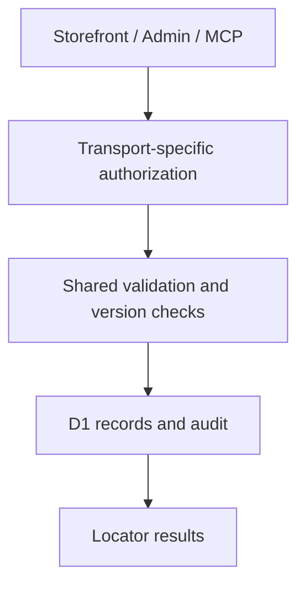

# Shopify Stockist Platform POC

A stockist-management proof of concept exposing a shared data service through a storefront app proxy, embedded administrative API and separately authenticated MCP endpoint.

**Technical showcase · Documentation only · Anonymized**

Shopify | Cloudflare Workers | Cloudflare D1 | JavaScript | MCP | Vitest | Leaflet

## Engineering problem

Public visitors need simple read access, while administrative and automation clients need controlled mutations. Those entry points must share validation and auditing without sharing the same trust level.

## Implementation scope

- Built a Worker and D1 service with signed app-proxy reads and separate administrative and MCP access paths.
- Implemented role-aware mutation checks, input validation and optimistic version checks.
- Added short-lived bound confirmation tokens, single-use deactivation confirmation and audit logging.
- Implemented OAuth and uninstall handling, retaining soft-deactivation rather than hard-delete routes.
- Created a theme app extension with searchable results, fallback handling and deferred map initialization and cleanup.

## Architecture at a glance

The following is an illustrative technical flow, not a client screenshot or a deployment topology.

## Evidence and delivery boundary

Staging proof of concept; no production launch or app-marketplace approval is claimed.

The private implementation includes integration tests for API and MCP mutation workflows, signed storefront visibility, audit attribution and uninstall behavior, plus extension structure and locator tests.

## Read more

- [Engineering decisions](docs/engineering.md)
- [Scope and evidence boundaries](docs/scope.md)

> This repository describes verified implementation work at a technical level. Original source, identities, business data and visual assets are intentionally omitted. It is not an installable application or a claim that the original private implementation is open source.
