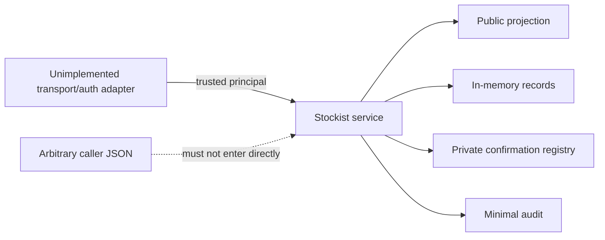

# Stockist Service Boundary

This repository contains an original, dependency-free Node.js demonstration of the authorization and state-transition boundary behind a multi-tenant stockist directory.

**Technical showcase · Executable synthetic demo · Anonymized**

The demo deliberately stays narrow: public active-stockist reads, trusted staff reads, role-gated updates, optimistic record versions and a bound two-step soft-deactivation. It is separate from the private staging proof of concept described in [Scope and evidence boundaries](docs/scope.md).

## Quick start

Requirements: Node.js 20 or newer. No package installation is required.

```sh
node --test
node demo/run.mjs
```

The test command currently runs 15 deterministic tests. The demo prints a minimal public projection, a versioned edit, caught stale and cross-tenant failures, a successful deactivation, public exclusion, caught token replay and a minimal audit log. It never prints confirmation tokens.

## What the executable demonstrates

- Records are addressed by an unambiguous `(tenant, id)` tuple.
- `publicList(tenant)` returns active records only and builds a dedicated minimal projection.
- `staffGet(principal, id)` accepts viewer, editor or admin roles.
- `update(principal, id, expectedVersion, patch)` accepts editors and admins, validates an exact patch shape and increments the version.
- `prepareDeactivation(...)` and `confirmDeactivation(...)` require admin permission.
- Confirmation state is private, random, short-lived, single-use, and bound to tenant, subject, action, record and prepared version.
- Permission is checked again at confirmation time. A rejected unauthorized caller does not consume the valid token.
- Snapshots, staff records and audit entries are defensive copies.

## Code map

| Path | Purpose |
| --- | --- |
| `src/stockist-service.mjs` | In-memory service, validation, authorization, versions, confirmations and audit |
| `test/stockist-service.test.mjs` | Deterministic behavioral and failure-invariant tests |
| `demo/run.mjs` | Synthetic command-line walkthrough |
| `docs/engineering.md` | Trust boundary, contracts, lifecycle, failure matrix and trade-offs |
| `docs/scope.md` | Public/private and implementation boundaries |

## Trust boundary



A principal is an explicit trusted output of a transport/authentication adapter. The `trusted: true` marker illustrates that contract; it does not authenticate arbitrary JSON. Real code must construct principals only after verifying a Shopify request, an authenticated admin session, or a separately authenticated automation channel. None of those adapters is implemented here.

## Limits

This is an in-memory mechanism demonstration, not production authentication, a security audit, a Shopify app, an MCP server, a database implementation or a deployed Worker. Each method performs synchronous atomic-looking steps in one JavaScript process. That does **not** provide database compare-and-swap, transactions, durability or cross-instance coordination. See [Engineering decisions](docs/engineering.md) for the persistence mapping.
