# Engineering decisions

## Principal trust and tenant authority

The service does not authenticate a caller. It accepts only this exact principal shape:

```js
{ subject: "staff-id", tenant: "shop-id", role: "viewer|editor|admin", trusted: true }
```

`subject`, `tenant` and `role` must be bounded strings/known values. The entire object is copied and validated on every call. The marker is a boundary assertion made by an **unimplemented trusted adapter**, not proof that arbitrary request JSON is authenticated. An HTTP handler must never spread request input into this shape.

The principal's `tenant` is authoritative for staff record lookup. The caller cannot pass a separate tenant to `staffGet`, `update`, `prepareDeactivation` or `confirmDeactivation`. Internally, records use a length-prefixed tuple key, so delimiter choices inside a valid tenant or ID cannot make two tuples collide.

Roles are deliberately small:

| Role | Staff read | Update | Prepare/confirm deactivation |
| --- | ---: | ---: | ---: |
| viewer | yes | no | no |
| editor | yes | yes | no |
| admin | yes | yes | yes |

## Exact data contracts

Seed record:

```js
{
  id, tenant, name, address,
  latitude, longitude,
  active, privateNotes,
  version // optional at construction; defaults to 1
}
```

IDs, tenant IDs, names and addresses are trimmed bounded strings. Notes are bounded strings and may be empty. Coordinates must be finite and inside latitude/longitude ranges. Versions must be positive safe integers. Unknown own keys, duplicate `(tenant, id)` tuples and prototype-bearing/non-plain containers are rejected. Seed records are copied into new service-owned objects.

Update patches are non-empty exact objects containing only `name`, `address`, `latitude`, `longitude` and/or `privateNotes`. IDs, tenants, active state and versions cannot be patched. Soft-deactivation is available only through its explicit confirmation lifecycle.

Public output is constructed field by field:

```js
{ id, name, address, latitude, longitude }
```

It is not a staff-record copy with fields removed. Therefore tenant, version, active state and private notes are absent by construction.

## Confirmation lifecycle

```mermaid
stateDiagram-v2
    [*] --> Prepared: admin + current version
    Prepared --> Rejected: wrong actor/tenant/role/action
    Prepared --> Expired: now >= expiresAt
    Prepared --> Stale: record version changed
    Prepared --> Consumed: validation succeeds; deactivate + version increment
    Consumed --> [*]
```



Preparation creates 32 random bytes encoded as base64url. The private registry binds the token to tenant, subject, action, record ID, prepared version and expiry. It does not mutate the record or audit log.

Confirmation validates the current principal and admin role before looking up or consuming an intent. It then checks binding, exact expiry (`now >= expiresAt` is invalid), record version and active state. Only a successful terminal application removes the token, updates the record and appends audit. This means a wrong role, actor or tenant cannot burn another caller's valid token. Replay fails after successful consumption.

The injected clock makes expiry tests deterministic and sleep-free. Clock values must be nonnegative safe integers; the service refuses an observed backward step instead of reviving an expired intent. TTL is limited to 1–300000 milliseconds, defaults to 30000, and expiry arithmetic must stay in the safe-integer range. The default clock is `Date.now`. This check does not turn wall-clock time into a monotonic elapsed-time source or detect unobserved clock changes; production adapters still need an explicit runtime-appropriate clock policy.

## Failure matrix

| Failure | Record mutation | Audit mutation | Valid token consumed |
| --- | ---: | ---: | ---: |
| Untrusted/malformed principal | no | no | no |
| Insufficient role | no | no | no |
| Cross-tenant record lookup | no | no | no |
| Unknown or cross-actor token | no | no | no |
| Exact-expiry or later | no | no | no |
| Intervening version change | no | no | no |
| Invalid patch/coordinate | no | no | n/a |
| Successful confirmation | active=false, version+1 | one entry | yes |
| Replay after success | no further change | no | already consumed |

## Versions versus database compare-and-swap

The in-memory service checks `record.version === expectedVersion` and then synchronously replaces a `Map` entry. No asynchronous work occurs between those steps, so the demo is coherent inside one JavaScript process. It is not a database transaction and does not protect multiple processes or Worker isolates.

A persistent adapter must make the comparison and write one atomic database operation, for example conceptually:

```sql
UPDATE stockists
SET name = ?, version = version + 1
WHERE tenant_id = ? AND id = ? AND version = ?;
```

Zero affected rows means stale or absent and must not create audit. Record update, confirmation consumption and audit insertion should share one real transaction. Confirmation storage also needs atomic single-use deletion or compare-and-delete, expiry cleanup, encryption/secret-management policy and bounded capacity. Those are not implemented here.

## Audit and copy isolation

Successful changes append only actor subject, tenant identifier, action, record ID, resulting version and sorted changed-field names. Tenant attribution is necessary because the same actor and record identifiers may occur in different tenants. Tokens, tenant configuration, coordinates, addresses, notes and full before/after payloads are intentionally absent. Whether that is sufficient for a regulated production audit is a separate policy decision.

Staff results, snapshots and audit getters return structured defensive copies. Caller mutation of inputs or returned data cannot alter service-owned records, confirmation state or prior audit entries.

`snapshot()` and `auditLog()` are process-internal diagnostic hooks for the test harness and CLI. They intentionally span tenants and have no principal parameter. They must not be exposed as public or staff transport operations. Public routes use only the explicit public projection; staff routes use the tenant-scoped methods and would require a separately authorized, scoped audit endpoint if one were added.

## Mapping to real transports (not implemented)

- **Shopify app proxy:** verify Shopify's signed proxy request, derive the shop/tenant server-side, then call only `publicList`. This demo does not implement signature verification or an HTTP route.
- **Embedded Admin API:** verify an authenticated Shopify admin session and map authorized staff/shop data into a trusted principal before staff methods. OAuth, session storage and Admin API calls are absent.
- **MCP/automation:** authenticate the automation connection separately, map its allowlisted subject/tenant/role into a trusted principal and expose only narrow tool schemas. No MCP protocol implementation exists here.
- **Database:** replace maps with tenant-filtered queries, atomic version predicates and transactional confirmation/audit persistence. No SQL or D1 execution is claimed.

Keeping adapters outside the service lets each transport use its real authentication mechanism without weakening the shared business boundary.
